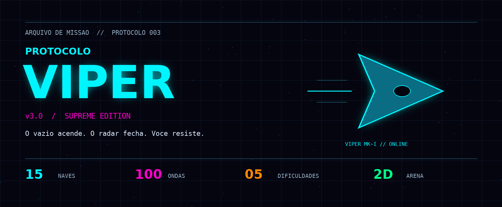

<div align="center">



# PROTOCOLO VIPER

**v3.0 · SUPREME EDITION**  
`HTML` · `CSS` · `JavaScript` · `Canvas 2D` · `Web Audio`

**Uma nave. Cem ondas. Nenhum código de extração.**

[Missão](#01--briefing) · [Arsenal](#02--hangar--arsenal) · [Jogar](#03--iniciar-protocolo) · [Controles](#04--comandos-do-piloto) · [Código](#05--engenharia-do-protocolo)

</div>

---

> **CANAL SEGURO // C.A.S.S.I.**  
> “Sistemas online. Calibrando sensores. Boa sorte, piloto.”

<a id="01--briefing"></a>

## 01 · Briefing

**Protocolo Viper** é um jogo de tiro espacial 2D, de visão superior, com combate de arena e ondas de inimigos. Você pilota uma nave, mira com o mouse, dispara, esquiva com dash e tenta atravessar **100 ondas** até concluir o protocolo.

A estética é de um terminal de guerra futurista: ciano elétrico, magenta, vermelho de alerta, grades animadas, partículas, explosões e brilho neon. No rádio, a **C.A.S.S.I.** acompanha a missão. Conforme o combate avança, as transmissões ficam menos tranquilas.

Não é uma viagem pelo espaço. É uma luta para continuar nele.

---

<a id="02--hangar--arsenal"></a>

## 02 · Hangar & arsenal

| FROTA | MISSÃO | AMEAÇA | EVOLUÇÃO |
| :---: | :---: | :---: | :---: |
| **15 naves** | **100 ondas** | **5 dificuldades** | **A cada 5 ondas** |

- **15 naves disponíveis**, cada uma com atributos, três opções de arma e uma habilidade especial ativa ou passiva.
- **5 dificuldades:** Easy, Normal, Hard, Impossible e Hell.
- **100 ondas**, com tipos de inimigos liberados progressivamente.
- **Melhorias a cada 5 ondas**, antes da onda final: escolha uma entre três opções sorteadas.
- **Chefes principais** nas ondas 10, 25, 50, 75 e 100; chefes de rotação em outras ondas múltiplas de 10.
- Pontuação, eliminações, combos, integridade da nave, cargas de dash e indicador da habilidade.
- Minimapa, registro de eliminações, alerta de pouca vida e contador de FPS.
- Player para carregar **suas próprias músicas MP3** durante a sessão.

<details>
<summary><strong>Abrir hangar — consultar as 15 naves</strong></summary>

### Frota disponível

| Nave | Classe do hangar | Habilidade |
| --- | --- | --- |
| VIPER MK-I | Equilibrada | Overdrive |
| PHANTOM X | Ágil / Stealth | Phase Shift |
| TITAN ZERO | Tanque pesado | Fortress Mode |
| SPECTER | Assassin | Shadow Step |
| PHOENIX | Regeneração | Rebirth |
| RAVEN | Drone Master | Drone Swarm |
| WRAITH | Lifesteal | Soul Harvest |
| ARES | Berserker | Blood Rage |
| NOVA | Area Denial | Supernova |
| CIPHER | Hacker | System Crash |
| ZERATH | Void Walker | Dimension Rift |
| ORION | Sniper | Orbital Strike |
| KHAOS | Randomizer | Entropy Wave |
| ECLIPSE | Time Manipulator | Time Stop |
| OMEGA | Ultimate | Omega Protocol |

Os nomes e as classes acima seguem o cadastro do jogo original; não são uma garantia de que todas as descrições de armas e habilidades tenham efeitos específicos implementados.


</details>

---

<a id="03--iniciar-protocolo"></a>

## 03 · Iniciar protocolo

1. Extraia **todo o ZIP**, mantendo as pastas juntas.
2. Abra `index.html` em um navegador moderno, preferencialmente Chrome, Edge ou Firefox.
3. Escolha a dificuldade e clique em **INICIAR PROTOCOLO**.
4. Selecione a nave e a arma inicial. Clique em **INICIAR MISSÃO**.

> **ACESSO IMEDIATO**  
> Não precisa instalar pacotes, compilar nem criar uma conta.

O jogo usa HTML, CSS e JavaScript puros. Os scripts são carregados em sequência, sem módulos, para permitir a abertura direta do arquivo.

Se o navegador limitar a execução de arquivos locais, uma alternativa é servir a pasta com Python 3:

```bash
python -m http.server 8000
```

Execute dentro da pasta `protocolo-viper` e acesse `http://localhost:8000`. Encerre com `Ctrl+C`.

### Checklist de decolagem

- **Teclado e mouse são necessários para o combate.** O visual contém ajustes para telas menores, mas não há controles de toque completos.
- As fontes **Orbitron, Rajdhani e Share Tech Mono** são carregadas pelo Google Fonts. Sem internet, o jogo usa fontes alternativas; o combate não depende desse serviço.
- Nenhuma música acompanha o pacote. Carregue arquivos MP3 locais no player; use faixas que você tenha autorização para utilizar.
- O áudio pode precisar de uma primeira interação com a página para ser liberado pelo navegador.
- Não há sistema de contas, salvamento permanente, ranking online ou multiplayer. Recarregar a página reinicia a sessão e a playlist.

---

<a id="04--comandos-do-piloto"></a>

## 04 · Comandos do piloto

| Ação | Comando |
| --- | --- |
| Mover | `W`, `A`, `S`, `D` ou setas |
| Mirar | Mouse |
| Disparar | Botão esquerdo do mouse |
| Dash | `Espaço` |
| Trocar arma | `1`, `2`, `3` |
| Habilidade especial ativa | `Q` |
| Pausar / continuar | `Esc` |
| Alternar player de música | `M` |
| Alternar minimapa | `Tab` |
| Pausar / retomar música, com player visível | `P` ou `K` |
| Próxima música, com player visível | `N` |
| Música anterior, com player visível | `B` |

Habilidades passivas, como Rebirth, não são acionadas por `Q`.

---

<a id="05--engenharia-do-protocolo"></a>

## 05 · Engenharia do protocolo

```text
protocolo-viper/
├── index.html              # Estrutura das telas e carregamento dos arquivos
├── README.md               # Este briefing
├── docs/
│   └── viper-banner.png    # Capa deste README
├── css/
│   ├── styles.css          # Visual neon, animações e ajustes de tela
│   └── interface.css       # Estilos estáticos antes escritos no HTML
└── js/
    ├── 01-config.js        # Canvas, configuração, ícones e catálogos do jogo
    ├── 02-state.js         # Estado da partida, entrada e variáveis de áudio
    ├── 03-visuals.js       # Utilitários, partículas, cenário, minimapa e alertas
    ├── 04-player.js        # Nave do jogador, armas, dash e habilidades
    ├── 05-enemies.js       # Inimigos e chefes
    ├── 06-combat.js        # Projéteis, minas, buracos negros, drones e feixes
    ├── 07-waves-ui.js      # Ondas, HUD, rádio e escolha de melhorias
    ├── 08-audio.js         # Playlist, leitura de MP3 e reprodução de áudio
    └── 09-game.js          # Menus, fluxo da partida, eventos e inicialização
```

### Acesso de manutenção

**HTML** define a estrutura; **CSS** cuida da aparência; **JavaScript** executa o jogo e atualiza as telas. Os estilos estáticos do HTML foram movidos para `css/interface.css`. Estilos e SVGs gerados durante a partida continuam no JavaScript, pois dependem dos dados da nave e do estado do combate.

Os arquivos JavaScript compartilham o mesmo escopo e precisam manter a ordem indicada no `index.html`. Não use `async` nem altere essa sequência sem revisar as dependências.

- Balanceamento, naves, armas, inimigos e melhorias: `js/01-config.js`.
- Cores, fontes, efeitos e organização visual: `css/styles.css`.
- Movimento e combate da nave: `js/04-player.js`.
- Progressão e escolha de melhorias: `js/07-waves-ui.js`.
- Controles e início da sessão: `js/09-game.js`.

---

## 06 · Registro de integridade

Esta entrega reorganiza o arquivo enviado por linguagens e por responsabilidades. **O JavaScript original foi preservado, sem mudança de regras, balanceamento ou correção de bugs.** Todos os desenhos do jogo são produzidos por Canvas e SVGs definidos no próprio código; não há uma pasta de imagens ausentes.

Algumas descrições do arquivo original anunciam efeitos que não têm tratamento específico completo na lógica. A organização não transforma essas descrições em funcionalidades novas. Limitações e comportamentos já existentes permanecem nesta versão.

O pacote não acrescenta uma licença de distribuição: respeite a autoria do código original e os direitos de músicas ou outros materiais que você adicionar.

---

> **C.A.S.S.I. // ÚLTIMA TRANSMISSÃO**  
> “N4O H4 C0D1G0 D3 3XTR4C40. R3P1T0: N4O H4 S41D4.”  
> **O radar está cheio. O protocolo continua.**
